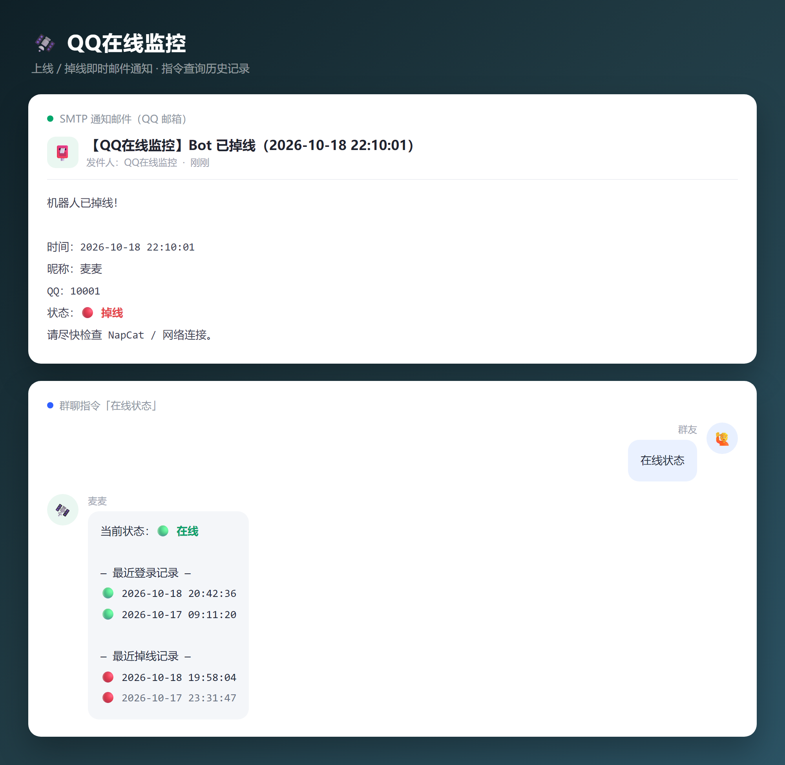

<div align="center">

# 🛰️ QQ在线监控

**掉线第一时间知道 —— 状态翻转自动发邮件，指令随时查历史**

[](https://github.com/Mai-with-u/MaiBot)
[](https://github.com/Mai-with-u/MaiBot)
[](#)
[](LICENSE)

</div>



---

## ✨ 功能特性

| | |
| --- | --- |
| 🔔 **翻转即通知** | 上线 / 掉线各发一封 SMTP 邮件，邮件标题带准确时间 |
| 🛡️ **防误报** | 连续失败阈值 + 消息宽限期，网络抖动、正好在聊天时都不会误判 |
| 🧩 **双通道探测** | 优先 `get_status`，回退 `get_login_info`，并对返回值做语义校验 |
| 🔁 **邮件必达** | 发送失败按 0 / 10 / 30 / 60 秒重试四次，断网恢复后告警仍能送达 |
| 📜 **本地留痕** | 最近 N 条上下线记录写入运行时数据目录，随时用指令查询 |
| 📦 **零三方依赖** | 邮件走标准库 `smtplib`，不需要额外安装任何 Python 包 |
| 🪶 **轻量** | 探测的是本地 NapCat HTTP 接口，10 秒一次的开销几乎可以忽略 |

## 💬 使用指令

| 指令 | 说明 |
| --- | --- |
| `在线状态` | 查看当前在线状态 + 最近 5 次登录 / 掉线记录 |
| `上下线记录` | 同上（两个指令等价，可在配置中自定义） |

> 默认仅管理员可用，配置项 `command.ps_only_su` 可关闭限制；修改指令后需重载插件。

## 🚀 快速安装

### 1. 放置插件

```text
MaiBot/plugins/WMX20081122_maibot-qq-monitor/
├── _manifest.json
├── plugin.py
├── config.py
├── mailer.py
└── config.toml        ← 复制 config.example.toml 而来
```

也可以直接在 **WebUI 插件市场** 搜索「QQ在线监控」一键安装。

### 2. 配置邮件

复制 `config.example.toml` 为 `config.toml`，填写邮箱信息：

```toml
[mail]
mail_enable = true
smtp_host = "smtp.qq.com"
smtp_port = 465
mail_sender = "你的QQ邮箱@qq.com"
mail_auth_code = "16位授权码"   # 不是登录密码
mail_to = "接收通知的邮箱@qq.com"
```

<details>
<summary>📮 如何获取 QQ 邮箱授权码</summary>

1. 登录 [QQ 邮箱网页版](https://mail.qq.com) → **设置** → **账号**
2. 找到「IMAP/SMTP 服务」并开启
3. 按提示生成 **16 位授权码**，填入 `mail_auth_code`
4. 授权码不要外传，泄露后请立即重置

</details>

### 3. 重载插件

保存后在 WebUI 重载插件或重启 MaiBot，日志出现 `QQ在线监控已加载` 即成功。

## ⚙️ 配置说明

| 配置项 | 默认值 | 说明 |
| --- | --- | --- |
| `plugin.enabled` | `true` | 插件总开关 |
| `admin.superusers` | `[]` | 管理员 QQ 列表（`ps_only_su` 生效时使用） |
| `admin.nickname` | `[]` | 机器人昵称，用于邮件与记录标识 |
| `mail.mail_enable` | `true` | 是否启用邮件通知 |
| `mail.smtp_host` / `smtp_port` | `smtp.qq.com` / `465` | SMTP 服务器与端口 |
| `mail.mail_sender` / `mail_auth_code` / `mail_to` | 空 | 发件邮箱 / 授权码 / 收件邮箱 |
| `mail.mail_subject_prefix` | `【QQ在线监控】` | 邮件标题前缀 |
| `monitor.probe_interval` | `10` | 正常状态下的探测间隔（秒） |
| `monitor.probe_retry_interval` | `10` | 疑似掉线后的复检间隔（秒） |
| `monitor.probe_timeout` | `10` | 单次接口调用超时（秒），机器繁忙时不要设太小 |
| `monitor.probe_fail_threshold` | `3` | 连续失败几次进入掉线候选 |
| `monitor.offline_confirm_seconds` | `60` | 失败持续多少秒才确认掉线并发通知 |
| `monitor.recover_success_threshold` | `3` | 连续成功几次才判定恢复上线 |
| `monitor.recover_confirm_seconds` | `20` | 成功持续多少秒才确认恢复上线 |
| `monitor.grace_seconds` | `30` | 收到消息后 N 秒内不判掉线 |
| `monitor.http_probe_host` / `http_probe_port` | `127.0.0.1` / `0` | 掉线前二次校验 NapCat 端口，填 0 关闭 |
| `monitor.notify_on_load` | `true` | 重启后探测到在线是否发上线邮件 |
| `monitor.record_max` | `50` | 本地最多保留记录条数 |
| `command.ps_command` | `["在线状态","上下线记录"]` | 查询指令（修改后需重载） |
| `command.ps_only_su` | `true` | 查询指令是否仅管理员可用 |

## ❓ 常见问题

<details>
<summary>为什么只收到上线邮件、收不到掉线邮件？</summary>

QQ 掉线常常同时伴随本机网络异常。插件已内置 0 / 10 / 30 / 60 秒的重试，网络恢复后仍会补发；如果仍然收不到，请检查 SMTP 授权码是否过期、垃圾邮件箱是否拦截。

</details>

<details>
<summary>为什么没有收到任何邮件？</summary>

先看日志里是否有 `邮件配置不完整，跳过发送`：发件邮箱、授权码、收件邮箱三项必须全部填写。

</details>

<details>
<summary>「在线状态」提示没有权限？</summary>

默认仅管理员可用。把 QQ 号加入 `admin.superusers`，或把 `command.ps_only_su` 改成 `false`。

</details>

<details>
<summary>为什么会收到「掉线」紧跟着「上线」的成对邮件？</summary>

主机繁忙时，适配器接口调用可能短暂超时，而不是 QQ 真的掉线。1.0.1 起加了三重保护：调用超时放宽到 10 秒、失败必须**持续 60 秒**才算掉线、判定前再确认 NapCat 端口是否可达。仍嫌敏感可以继续调大 `monitor.offline_confirm_seconds`。

</details>

<details>
<summary>记录数据保存在哪？</summary>

保存在 MaiBot 运行时分配给插件的数据目录（`monitor_records.json`），卸载/更新插件不会丢失；旧版本写在插件目录下的 `data/` 里，会按需自动迁移。

</details>

## 🧱 环境要求

- MaiBot ≥ 1.0.0，插件 SDK 2.x
- 适配器插件 [`maibot-team.snowluma-adapter`](https://github.com/Mai-with-u/MaiBot-SnowLuma-Adapter)（通过 `ctx.api.call` 访问 NapCat 接口）
- 无需安装第三方 Python 包

## 📝 更新日志

**v1.0.2**

- WebUI 里关闭插件后再打开即刻恢复探测，不再需要重载插件
- 卸载时取消未完成的邮件重试任务，避免重载后残留 pending task 告警
- 统一触发指令默认值（插件内默认与 README / 示例配置一致）
- 发送者识别改用文档承诺的 `message.message_base_info` 字段，保留旧字段回退
- 版本区间声明收紧为 MaiBot 1.3.x + SDK 2.12.0（MaiBot 1.4 发布后会跟进测试与更新）

**v1.0.1**

- 修复误报：接口调用超时不再被当成掉线（超时放宽到 10 秒、失败需持续 60 秒）
- 新增二次校验：判定掉线前连接 NapCat HTTP 端口，可达则视为调用通道抖动
- 新增 `offline_confirm_seconds` / `recover_confirm_seconds` / `probe_timeout` 等配置
- 日志中的异常改为带类型名输出，便于排查

**v1.0.0**

- 首个版本：上下线探测、SMTP 邮件通知、记录查询

## 📄 许可证

[MIT](LICENSE) © 2026 WMX20081122

<div align="center">

如果这个插件帮到了你，欢迎点一个 ⭐ Star

</div>
